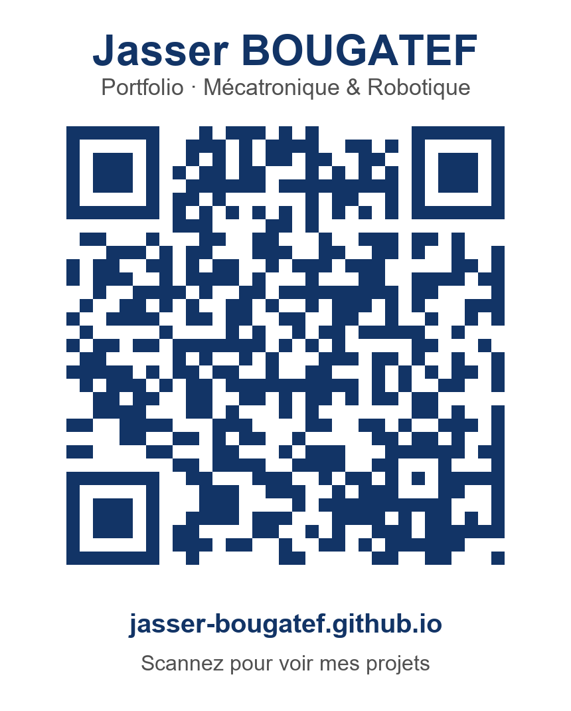

<table>
<tr>
<td>

## Jasser Bougatef

**Élève-ingénieur en mécatronique & robotique** · SIGMA Clermont · ENISo
Ingénieur R&D en alternance chez AluK · **disponible en CDI dès septembre 2027**

🌐 **Portfolio : [jasser-bougatef.github.io](https://jasser-bougatef.github.io/)**
💼 [LinkedIn](https://www.linkedin.com/in/bougatef-jasser-724228361/) · 📍 Clermont-Ferrand, France

</td>
<td width="170" align="center">

</td>
</tr>
</table>

### Projets

| Projet | Description | Stack |
|---|---|---|
| 🤖 [**ur3e-bin-picking**](https://github.com/jasser-bougatef/ur3e-bin-picking) | Bras UR3e + caméra RealSense : segmentation YOLOv11, axe de prise par ACP, pick-and-place MoveIt 2 | ROS 2 · MoveIt 2 · YOLOv11 · Python |
| ⚔️ [**venom-combat-robot**](https://github.com/jasser-bougatef/venom-combat-robot) | Robot de combat avec une arme de 6 kg : CAO, cartes STM32 reflashées, commande ESP32, simulation de choc | SolidWorks · Abaqus · STM32 · ESP32 |
| 🍇 **vine-3d-reconstruction** | Reconstruction 3D de pieds de vigne (RGB-D + GNSS RTK/PPK), stage au laboratoire IMS Bordeaux | C++ · Open3D · RTKLIB · Streamlit |

### Compétences
`ROS 2` `MoveIt 2` `Gazebo` `Python` `C++` `Open3D` `PCL` `YOLOv11` `PyTorch` `STM32` `ESP32` `SolidWorks` `CATIA` `Abaqus` `AMDEC / FMEA`
